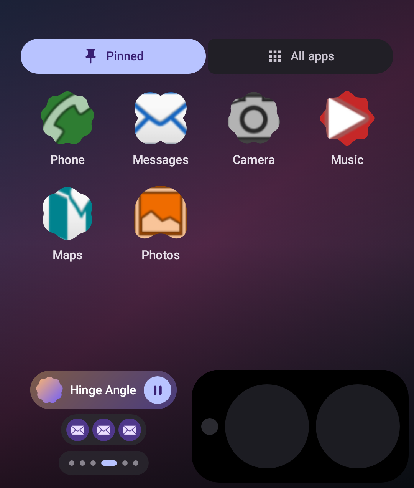
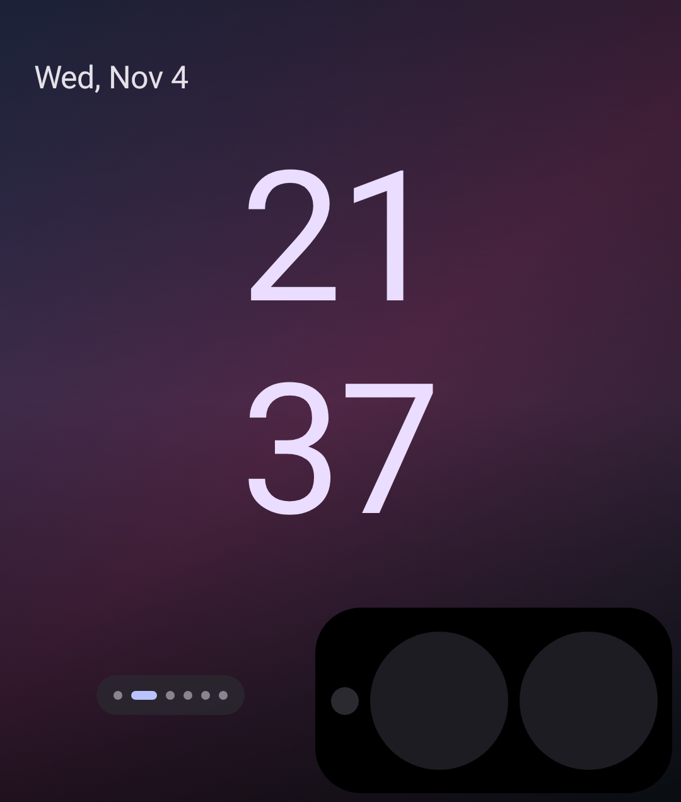
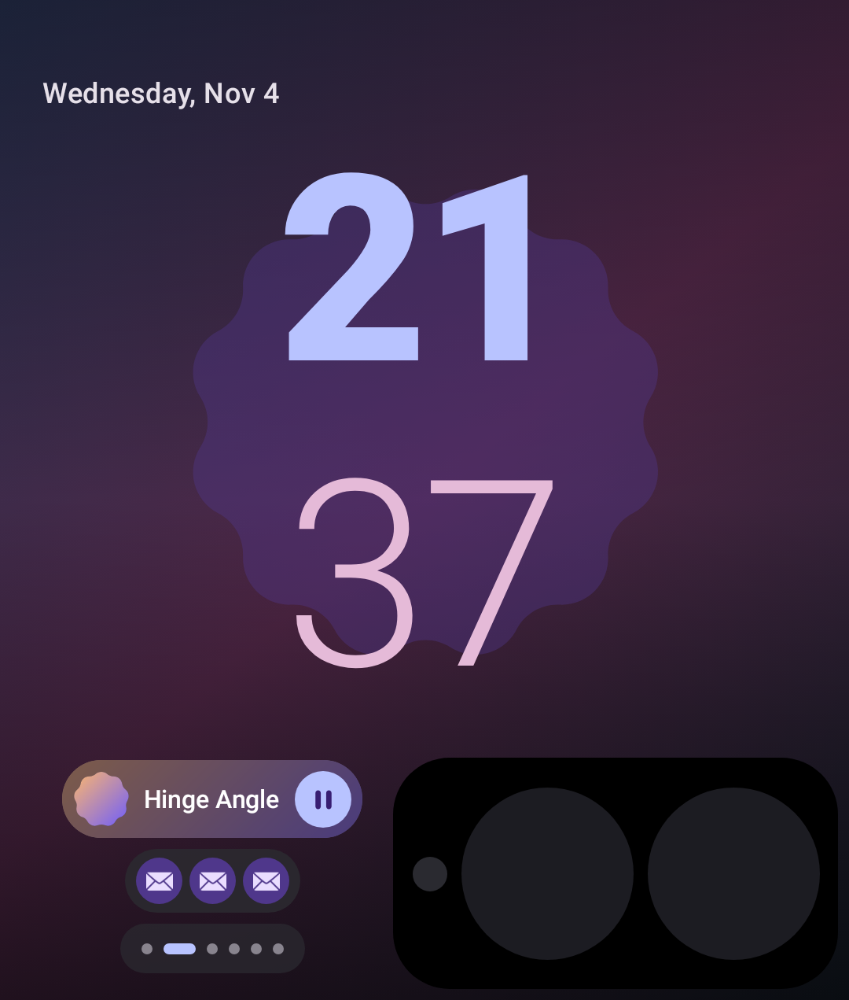
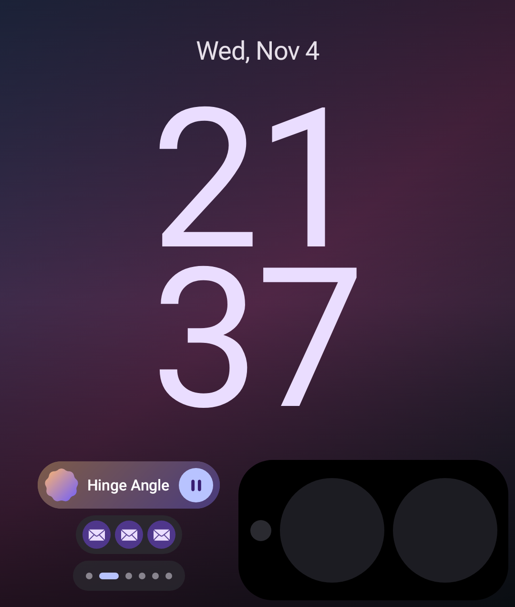
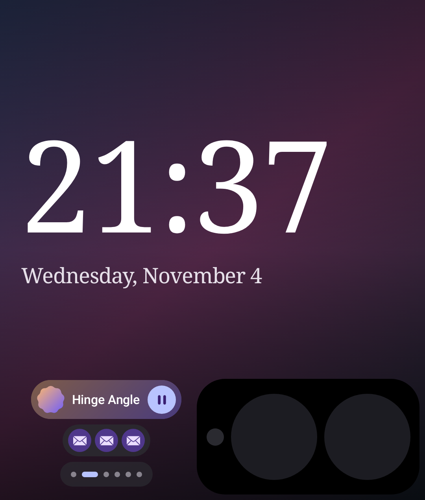
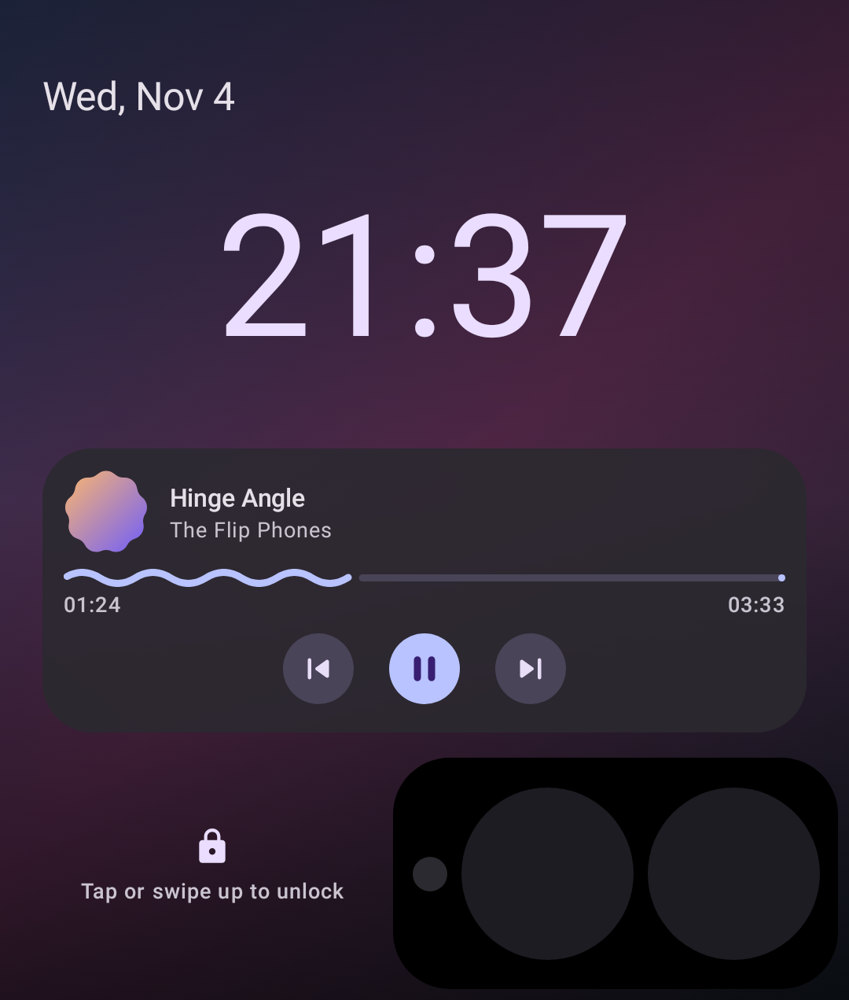
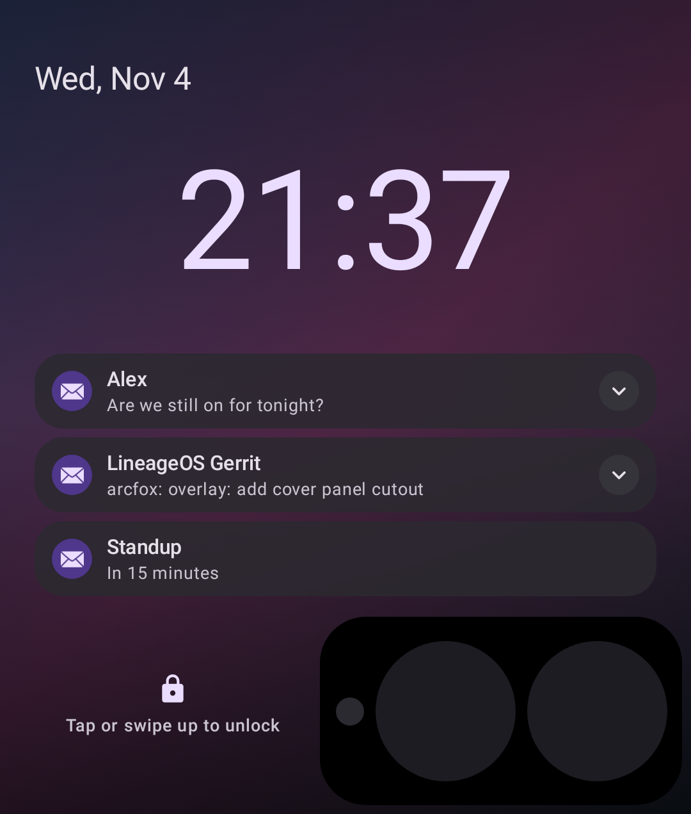
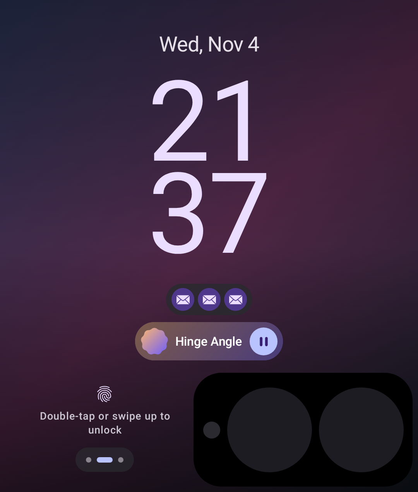
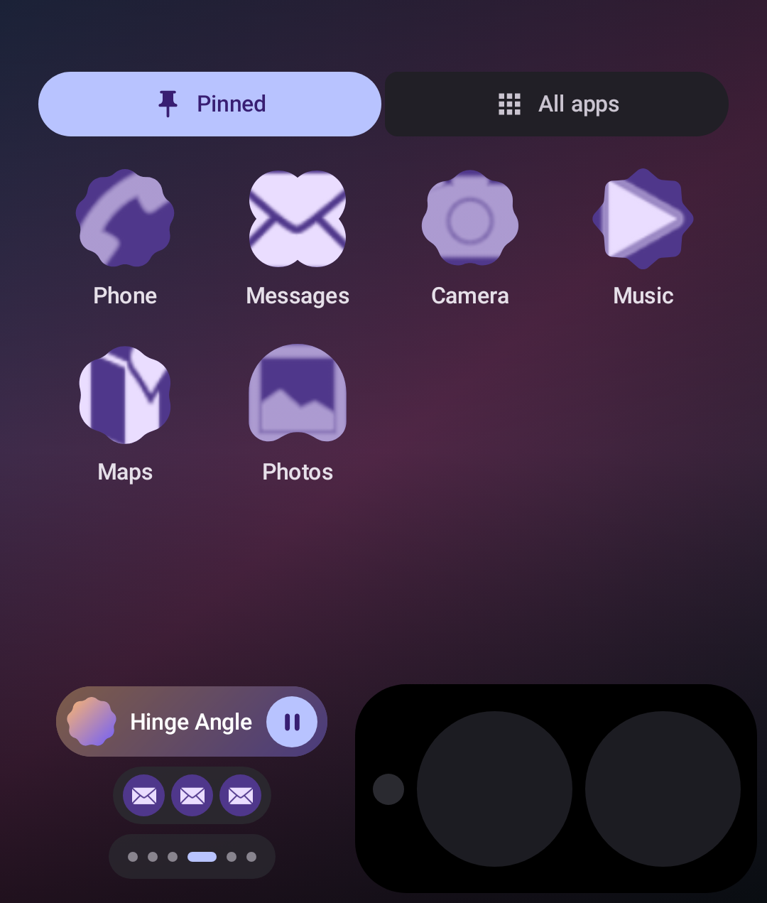

# FlipSlop

Лаунчер внешнего экрана (cover screen) для раскладушек на **LineageOS 23** (Android 16).
Сделан на Jetpack Compose и **Material 3 Expressive**. Работает как обычное приложение,
а если встроить его в прошивку как priv-app, обходится без дополнительных разрешений.

Эталонное устройство: Motorola razr 50 Ultra / razr+ 2024 (`arcfox`).

| Главная | Уведомления | Музыка |
|:-:|:-:|:-:|
|  |  |  |
| **Приложения** | **Виджеты** | **Переключатели** |
|  |  |  |

Скриншоты сняты Roborazzi в конфигурации обложки arcfox: 1080×1272 px при 360 dpi, то есть 480×565 dp.
Чёрный блок справа внизу показывает камеры (так же он нарисован в превью в настройках).

Когда уведомлений нет и ничего не играет, Home показывает часы в стиле экрана блокировки AOSP:



## Док у камеры

Справа внизу обложки arcfox стоит блок камер. Полоса слева от него используется как док: там живут
плашка «сейчас играет», значки приложений с уведомлениями и точки страниц. Музыку и уведомления можно
убрать из дока, тогда они показываются на Home.

Панель страниц по умолчанию спрятана: между страницами листают свайпом, а тап по точкам выдвигает
панель над камерами на 4 секунды. Её можно закрепить настройкой «Всегда показывать панель страниц»,
а точки можно убрать совсем («Точки страниц»), тогда остаётся только свайп.

## Прочее

- **Виджеты** добавляются прямо с обложки: кнопка «+» на странице виджетов открывает выбор с превью
  самих виджетов, а диалог привязки и настройка виджета появляются тоже на обложке.
- **Обложка трека** размыто заполняет фон страницы музыки и плашку «сейчас играет» (отключается).
- **Статусбар** системы виден на обложке, навбар скрыт (статусбар тоже можно спрятать).
- На страницах музыки и уведомлений их собственные плашки из дока уходят, чтобы не дублировать страницу.
- **Уведомления раскрываются** стрелкой справа, как в системной шторке: видно весь текст, переписку
  в мессенджерах (последние 8 сообщений, с отправителями и временем), строки сводок (InboxStyle), картинку
  (BigPictureStyle), прогресс и подстрочник. Работает в обоих стилях страницы уведомлений, в карточках
  на главном и на экране блокировки (рядом с часами раскрытая карточка прокручивается). Скрытые по
  правилам Android уведомления на блокировке не раскрываются.
- Тап по плашке музыки (в доке, на главном экране, на экране блокировки) или по карточке плеера открывает
  управление музыкой: страницу «Музыка», если она есть среди страниц (на блокировке — среди вкладок
  блокировки), а если нет — слайд с плеером поверх обложки. Закрывается свайпом вниз, «Назад» или кнопкой
  «Свернуть» у камер. В плеер переходит тап по большой обложке на этом слайде.

## Режимы

- **Главный экран**: «Карточки» (как на экране блокировки: часы, уведомления и плеер), «Часы и док»
  (экспрессивные часы, а музыка и уведомления плашками у камер) или «Большие часы» (только время на
  всю страницу).
- **Страница уведомлений**: «Компактно» (карточки как на экране блокировки) или «Подробно» (с кнопками
  действий и ответом).

| Карточки | Часы и док |
|:-:|:-:|
|  |  |

Часы настраиваются в «Оформление и стиль → Часы»: шрифт (системный, Roboto Flex, узкий, с засечками,
моноширинный, рукописный, Casual), толщина, размер, раскладка, выравнивание, цвет, 12/24 часа,
секунды, вид и положение даты.

| Большие часы | Настроенные |
|:-:|:-:|
|  |  |

Настройки разбиты по разделам: Доступ, Поведение, Экран блокировки, Обложка, Оформление и стиль,
Возле камеры, Диагностика.

## Экран блокировки

Пока телефон заблокирован, обложка показывает свой экран блокировки. После разблокировки открывается
вся обложка. Всё настраивается в «Экран блокировки», сверху живое превью:

Обложка работает сразу после перезагрузки, ещё до первого ввода PIN (Direct Boot): приложение
`directBootAware`, стартует по `LOCKED_BOOT_COMPLETED`, а настройки лежат в device protected storage.
Версии до этого хранили их в обычном (credential encrypted) хранилище; при первой разблокировке
FlipSlop переносит их сама. До первой разблокировки нет виджетов (`AppWidgetService` их не отдаёт),
в списке приложений только direct boot aware, а отпечаток Android не принимает, поэтому значок замка
вместо отпечатка. После ввода PIN всё это появляется само.

- **Раскладка**: «Карточки» (дата, часы, уведомления, плеер с перемоткой и временем) или «Большие часы»
  (плеер становится компактной плашкой). Шрифт, толщина, цвет и дата общие с обложкой, настраиваются в
  «Часы».
- **Уведомления**: скрыты, значки приложений или карточки. Всегда по правилам Android: скрытые не
  показываются, у личных видно только приложение, если в системе не разрешено показывать конфиденциальное.
- **Музыка**: плеер на блокировке или нет.
- **Вкладки на блокировке**: уведомления (тоже по правилам Android), музыка и переключатели. Листаются без
  разблокировки, точки возле камер. Открыть уведомление, плеер или настройки можно только после
  разблокировки, и обложка сама её попросит. Приложения и виджеты на блокировку не пускаются. После
  каждой блокировки обложка снова открывается на часах.
- **Жест разблокировки**: нажатие или свайп вверх, только свайп, двойное нажатие или свайп.
- **Значок замка и подсказка**: сверху (по умолчанию), у камер или скрыты. Текст меняется под жест,
  нажатие на подсказку разблокирует всегда.
- **Возле камер**: чипы, как в доке. Чип музыки (тап открывает управление музыкой) убирает плеер со
  страницы, и часам достаётся больше места. Значки уведомлений в режиме «Значки» переезжают сюда же.
  Оба чипа включаются по отдельности, на своих вкладках прячутся. Тап по значкам уведомлений (у камер
  или под часами) показывает уведомления без разблокировки: вкладку «Уведомления», если она есть среди
  вкладок блокировки, иначе слайд поверх обложки. Правила Android те же: скрытые не показываются, у
  личных виден только текст «Содержимое скрыто», если в системе не разрешено показывать конфиденциальное.
  Тап по карточке разблокирует и открывает уведомление. Закрывается свайпом вниз, «Назад», «Свернуть»
  или когда гаснет экран.
- **Отпечаток пальца**: в системной сборке просто касание сканера, как на системном экране; без оверлея
  SystemUI выключен, по жесту или сразу (см. ниже).

Если выключить «Свой экран блокировки», поверх блокировки показывается вся обложка, как раньше.

| Карточки, музыка у камер | С уведомлениями | Большие часы, вкладки, отпечаток | Подсказка у камер, без чипов |
|:-:|:-:|:-:|:-:|
|  |  |  |  |

### Отпечаток прямо с экрана блокировки обложки

В системной сборке отпечаток работает как на системном экране блокировки: приложил палец к сканеру, и
обложка разблокировалась, без окон и подтверждений. Пока приложение перекрывает keyguard, SystemUI
обычно перестаёт слушать сканер. Исключение составляют пакеты из её
`config_fingerprint_listen_on_occluding_activity_packages` (`KeyguardUpdateMonitor`), и FlipSlop
добавляет себя туда статическим RRO `lineage/overlay/FlipSlopSystemUIOverlay`. Отпечаток проверяет и
принимает сама SystemUI, keyguard уходит из-под обложки, а `ACTION_USER_PRESENT` открывает всю обложку.
Правила Android те же, что на системном экране: после перезагрузки нужен PIN, после неудачных попыток
сканер блокируется. Для бокового сканера должно быть включено «Разблокировка касанием в любое время»,
иначе SystemUI ждёт нажатия кнопки. Жест разблокировки открывает обычный ввод пароля (там отпечаток
тоже работает). Агент доверия и `BiometricPrompt` в этом режиме выключены, а строка «Отпечаток пальца»
в настройках просто сообщает, что всё работает как в системе (`unlock/SystemFingerprint.kt` читает этот
список SystemUI).

`USER_PRESENT` присылает SystemUI, а не системный uid. Поэтому его приёмники зарегистрированы как
exported: `RECEIVER_NOT_EXPORTED` его молча не получает, и обложка оставалась на экране блокировки уже
после разблокировки. Все три действия (`USER_PRESENT`, `SCREEN_ON`, `SCREEN_OFF`) защищены, подделать их
приложения не могут.

#### Запасной вариант без оверлея SystemUI

Если оверлея нет, приложение поверх блокировки само слушать сканер не может. Боковые и подэкранные
сканеры отвечают сторонним приложениям только через системное окно биометрии. Тогда работает схема как
у Active Unlock в Android 13+ (например, разблокировка часами):

1. Отпечаток проверяет система, через `BiometricPrompt`, только сильная биометрия (класс 3). FlipSlop
   отпечаток не видит.
2. После совпадения агент доверия FlipSlop (`unlock/CoverTrustAgent.kt`) снимает блокировку:
   `grantTrust` с `TEMPORARY_AND_RENEWABLE`, `INITIATED_BY_USER` и `DISMISS_KEYGUARD`.
3. Заранее агент выдаёт такое же продлеваемое доверие, пока телефон разблокирован. Когда экран гаснет,
   `TrustManagerService` переводит его в «trustable», и только из этого состояния агент может
   разблокировать.

Ограничения Android при этом остаются в силе. После перезагрузки, lockdown, через 24 часа после
последнего ввода PIN-кода или отпечатка на системном экране и через 8 часов простоя Android снова
попросит PIN. В этих случаях обложка сразу открывает обычный ввод пароля. Туда же ведут кнопка «PIN-код»
в окне отпечатка и блокировка сканера после неудачных попыток.

Режимы:

- «По жесту»: жест разблокировки вызывает окно отпечатка вместо ввода пароля.
- «Сразу»: окно появляется само каждый раз, когда обложка просыпается заблокированной, остаётся
  только приложить палец.

Нужна системная сборка: `PROVIDE_TRUST_AGENT` выдаётся только priv-app. Агент появляется в
«Настройки › Безопасность › Агенты доверия». Android включает его сам, потому что он системный (если в
прошивке не задан `config_defaultTrustAgent`). Строка «Отпечаток пальца» в настройках подсказывает, чего
не хватает: системной сборки, отпечатка, агента доверия или первой разблокировки PIN-кодом.

## Оформление и стиль

Раздел настроек со стилем часов, часами в покое, обложкой трека и значками:

- **Форма значков**: экспрессивный микс форм Material, круг, скруглённый квадрат или «как в системе»
  (маска из `AdaptiveIconDrawable.getIconMask()`, то есть форма, выбранная в «Обоях и стиле»).
- **Размытие**: обоев за обложкой (системное размытие окна, нужна поддержка устройства и выключенная
  экономия энергии) и обложки трека на странице музыки, оба ползунком.
- **Тематические значки**: выкл, вкл или «как в системе». Рисуется монохромный слой иконки в цветах
  обоев; у приложений без такого слоя берётся силуэт переднего слоя. Режим «как в системе» читает
  переключатель из «Обоев и стиля», который хранит Trebuchet
  (`content://com.android.launcher3.grid_control/icon_themed`, право
  `com.android.launcher3.permission.READ_SETTINGS`, signatureOrSystem). Поэтому он работает только в
  системной сборке из `lineage/`; обычный APK показывает обычные значки и пишет об этом в настройках.

| Круг | Тематические |
|:-:|:-:|
|  |  |
Сторона, ширина и высота блока камер настраиваются в разделе «Возле камеры», превью сверху сразу
показывает результат.

Страница уведомлений стоит перед Home: свайп вправо от часов открывает уведомления.

## Как это устроено

В дереве arcfox (`configs/displayconfig/display_layout_configuration.xml`) в сложенных состояниях
(0–3) логический дисплей 0 переключается на внешнюю панель, а внутренняя выключается. Значит обложка
не является вторичным дисплеем, и HOME на оба экрана один. Поэтому FlipSlop не подменяет лаунчер
(Trebuchet остаётся HOME вместе с жестами Quickstep), а **поднимает свою активити, когда телефон
закрывают**, и закрывает её, когда открывают.

Положение шарнира определяется так, от точного источника к общему:

1. **`DeviceStateManager`**: скрытый API, доступен системной сборке. Состояния сверяются с
   `config_foldedDeviceStates` / `config_halfFoldedDeviceStates` / `config_openDeviceStates`
   из overlay устройства.
2. **Активная панель дисплея 0** (публичный `DisplayManager`). Обложка почти квадратная и меньше
   внутренней панели. Размеры панелей запоминаются в процессе работы.
3. **Датчик угла шарнира** (`TYPE_HINGE_ANGLE`) решает спорные случаи и даёт состояние «приоткрыт».

Классификатор (`fold/CoverDisplayClassifier.kt`) покрыт тестами на значениях arcfox.

## Уровни доступа

| Возможность | Обычный APK | Что выдать | priv-app (`lineage/`) |
|---|---|---|---|
| Открываться при закрытии | – | «Поверх других приложений» и/или «Полноэкранные уведомления» | `START_ACTIVITIES_FROM_BACKGROUND` |
| Уведомления, ответы, музыка, «Не беспокоить» | – | Доступ к уведомлениям | RRO `config_defaultListenerAccessPackages` |
| Работа в фоне без постоянного уведомления | foreground-сервис | Доступ к уведомлениям | то же |
| «Домой» на обложке возвращает в FlipSlop | – | Доступ к истории использования | `PACKAGE_USAGE_STATS` |
| Виджеты | с диалогом подтверждения | – | `BIND_APPWIDGET`, без диалога |
| Яркость | только окна | «Изменение системных настроек» | выдаётся как preinstalled |
| Wi-Fi / Bluetooth в один тап | системная панель | – | напрямую |
| Точное положение шарнира | по панели и датчику | – | `DeviceStateManager` (hidden-API allowlist) |
| Отпечаток прямо с блокировки обложки | – (жест открывает системный ввод пароля) | – | RRO SystemUI `config_fingerprint_listen_on_occluding_activity_packages`, как на системном экране; без него `PROVIDE_TRUST_AGENT`, агент доверия |

Начиная с Android 15, `SYSTEM_ALERT_WINDOW` разрешает запуск из фона только при видимом overlay-окне.
Поэтому FlipSlop на долю секунды ставит прозрачный 1px overlay (`service/OverlayAnchor.kt`). Если
запуск всё равно заблокирован, срабатывает full-screen intent: на выключенном или заблокированном
экране он открывает обложку сразу, а в остальных случаях появляется уведомление.

## Сборка

Нужны JDK 17+ и Android SDK с `platforms;android-37.0` (его требует `core-ktx` из дерева Lineage) и
`platforms;android-36`: на нём компилируется `systemstubs/`, заглушка системного API `TrustAgentService`.
Она нужна только для компиляции и в APK не попадает. Soong собирает приложение с `system_current`, где
этот класс есть.
Версии библиотек в Gradle совпадают с `prebuilts/sdk/current/androidx` LineageOS 23 (Android 16 QPR2:
Compose 1.10.0-alpha01, Material 3 1.4.0-alpha17 и т. д.), а Kotlin ограничен языком 2.2, как
`kotlinc` в AOSP. Поэтому Gradle и Soong собирают один и тот же код. Единственное расхождение:
`datastore-preferences` 1.2.0-alpha03 из дерева на Maven не публиковалась, Gradle берёт 1.2.0-alpha02.
targetSdk = 36 (LineageOS 23).

```bash
./gradlew :app:assembleDebug
```

```bash
./gradlew :app:testDebugUnitTest :app:lintDebug
```

Перерисовать скриншоты:

```bash
./gradlew :app:recordRoborazziDebug
```

## Установка как обычного приложения

```bash
adb install -r app/build/outputs/apk/debug/app-debug.apk
```

Дальше откройте FlipSlop на внутреннем экране и выдайте права по карточкам в разделе «Доступ».
Можно и через adb:

```bash
adb shell appops set com.tuki.flipslop SYSTEM_ALERT_WINDOW allow
```

```bash
adb shell cmd notification allow_listener com.tuki.flipslop/com.tuki.flipslop.notifications.CoverNotificationListener
```

```bash
adb shell appops set com.tuki.flipslop GET_USAGE_STATS allow
```

```bash
adb shell appops set com.tuki.flipslop WRITE_SETTINGS allow
```

Проверка без складывания телефона:

```bash
adb shell cmd device_state state 0
```

```bash
adb shell cmd device_state state reset
```

## Встраивание в LineageOS

FlipSlop собирается из исходников вместе с прошивкой, без готовых APK: `Android.bp` в корне описывает
`android_app` на тех же Kotlin-исходниках и ресурсах, что и Gradle, с библиотеками из
`prebuilts/sdk` дерева.

1. Положите репозиторий в `packages/apps/FlipSlop` (например, через local manifest).
2. В `device.mk` устройства:
   ```make
   $(call inherit-product-if-exists, packages/apps/FlipSlop/lineage/flipslop.mk)
   ```
3. Соберите прошивку как обычно (`breakfast arcfox && brunch arcfox`) или только приложение:
   ```bash
   m FlipSlop
   ```

В образ попадут (`system_ext`):

- `priv-app/FlipSlop`;
- `etc/permissions/privapp-permissions-com.tuki.flipslop.xml`;
- `etc/default-permissions/default-permissions-com.tuki.flipslop.xml` (`POST_NOTIFICATIONS`, `BLUETOOTH_CONNECT`);
- `etc/sysconfig/sysconfig-com.tuki.flipslop.xml` (`hidden-api-whitelisted-app`, `allow-in-power-save`);
- `FlipSlopFrameworksOverlay` с `config_defaultListenerAccessPackages`.

Манифест для Soong (`lineage/AndroidManifest.xml`) несёт только имя пакета: его требует aapt2, а AGP
не разрешает указывать его в исходном манифесте. Всё остальное подмешивается из
`app/src/main/AndroidManifest.xml`. Версия задаётся в двух местах: `app/build.gradle.kts` и
`aaptflags` в `Android.bp`.

## Значения arcfox, взятые за основу

| Что | Значение | Откуда |
|---|---|---|
| Внешняя панель | 1080×1272, 360 dpi (480×565 dp), id `4630947043778501764` | `configs/displayconfig/display_id_4630947043778501764.xml` |
| Внутренняя панель | 1080×2640, id `4630947043778501763` | `device.mk`, `display_layout_configuration.xml` |
| Сложенные состояния | 0–3, приоткрыт: 4, открыт: 5–6 | `FrameworksResArcfox` |
| Высота блока камер | 143 dp | `SystemUIResArcfox/values-sw430dp` (`keyguard_indication_margin_bottom`) |
| Ширина блока камер, сторона | 264 dp, справа | измерено по фото устройства, в дереве этого нет |

Блок камер настраивается в FlipSlop: «Возле камеры».

## Структура

```
app/src/main/java/com/tuki/flipslop/
  fold/           определение положения шарнира
  service/        рантайм, запуск обложки, сервис, QS-плитка, возврат после «Домой»
  notifications/  NotificationListenerService и действия с уведомлениями
  media/ apps/ widgets/ toggles/   источники данных для панелей
  ui/cover/       сама обложка (CoverActivity + страницы)
  ui/settings/    настройки и онбординг на внутреннем экране
  unlock/         отпечаток с экрана блокировки: системный BiometricPrompt + агент доверия
lineage/          интеграция в прошивку
systemstubs/      заглушки @SystemApi для Gradle (только компиляция)
```
