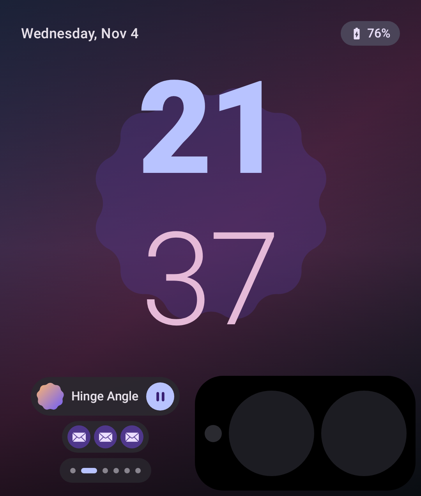
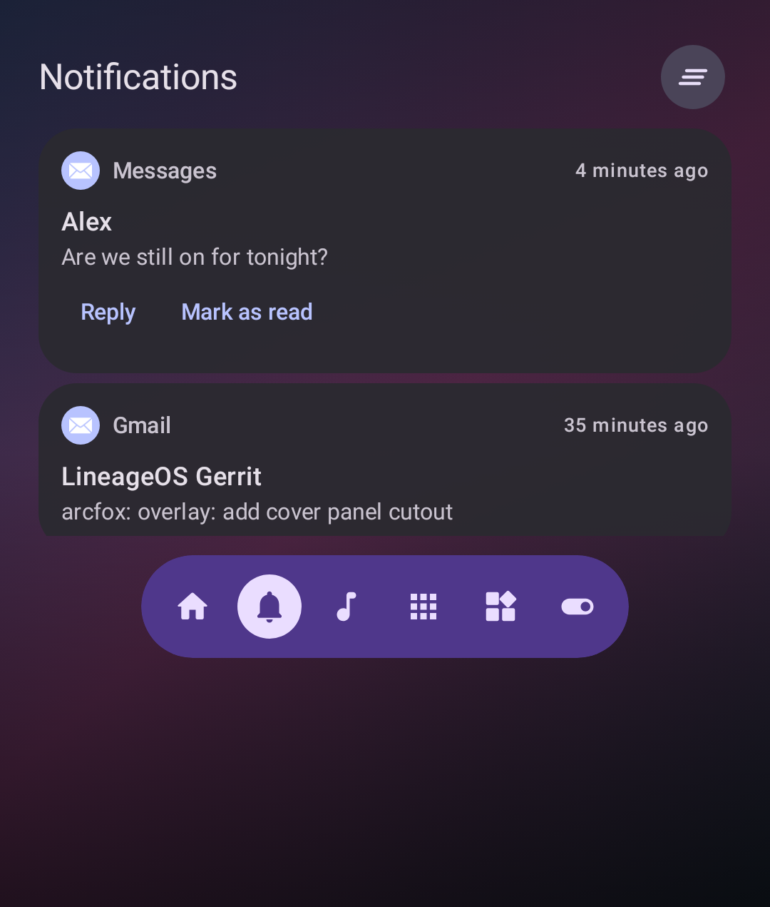
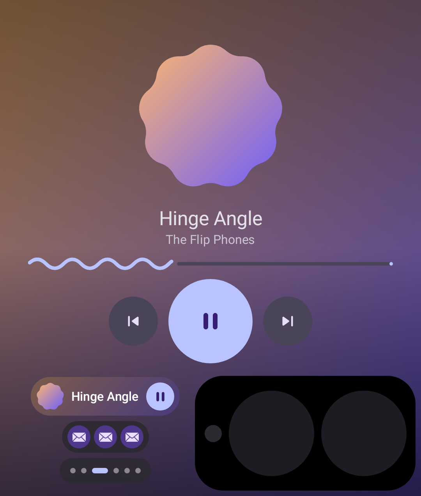
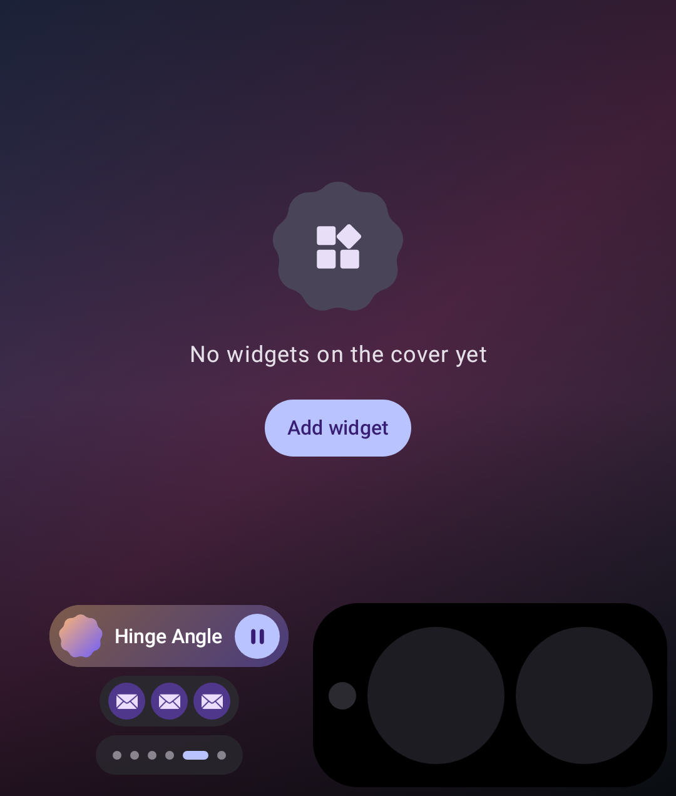
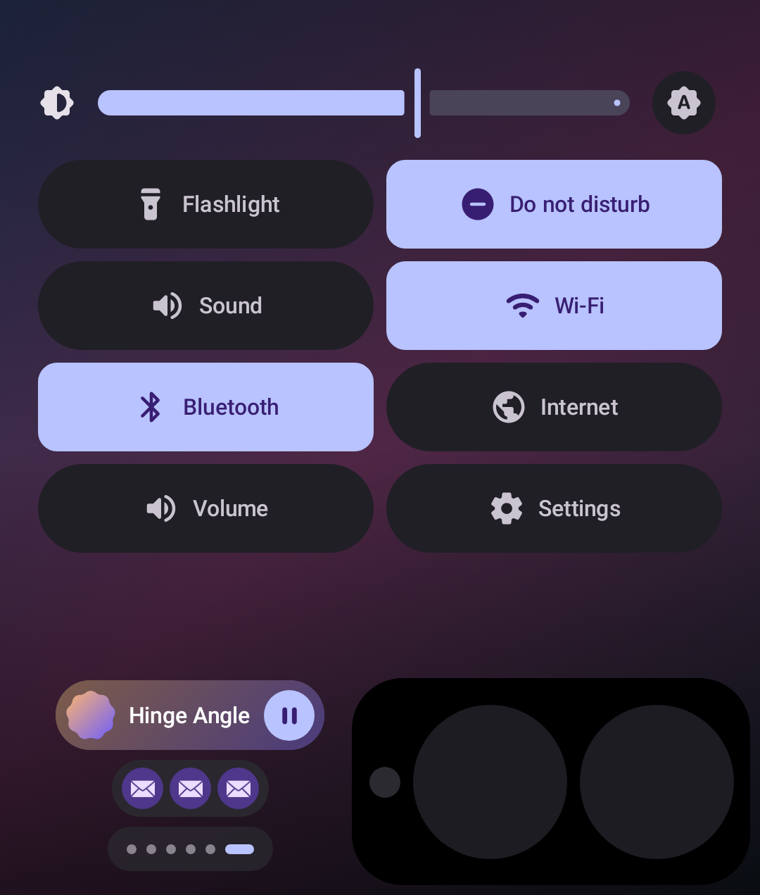

# FlipSlop

Лаунчер внешнего экрана (cover screen) для раскладушек на **LineageOS 23** (Android 16).
Сделан на Jetpack Compose и **Material 3 Expressive**. Работает как обычное приложение,
а если встроить его в прошивку как priv-app, обходится без дополнительных разрешений.

Эталонное устройство: Motorola razr 50 Ultra / razr+ 2024 (`arcfox`).

| Главная | Уведомления | Музыка |
|:-:|:-:|:-:|
|  |  |  |
| **Приложения** | **Виджеты** | **Переключатели** |
|  |  |  |

Скриншоты сняты Roborazzi в конфигурации обложки arcfox: 1080×1272 px при 360 dpi, то есть 480×565 dp,
с отступом 143 dp под камеры.

## Как это устроено

В дереве arcfox (`configs/displayconfig/display_layout_configuration.xml`) в сложенных состояниях
(0–3) логический дисплей 0 переключается на внешнюю панель, а внутренняя выключается. Значит обложка
не является вторичным дисплеем, и HOME на оба экрана один. Поэтому FlipSlop не подменяет лаунчер
(Trebuchet остаётся HOME вместе с жестами Quickstep), а **поднимает свою активити, когда телефон
закрывают**, и закрывает её, когда открывают.

Положение шарнира определяется так, от точного источника к общему:

1. **`DeviceStateManager`**: скрытый API, доступен системной сборке. Состояния сверяются с
   `config_foldedDeviceStates` / `config_halfFoldedDeviceStates` / `config_openDeviceStates`
   из overlay устройства.
2. **Активная панель дисплея 0** (публичный `DisplayManager`). Обложка почти квадратная и меньше
   внутренней панели. Размеры панелей запоминаются в процессе работы.
3. **Датчик угла шарнира** (`TYPE_HINGE_ANGLE`) решает спорные случаи и даёт состояние «приоткрыт».

Классификатор (`fold/CoverDisplayClassifier.kt`) покрыт тестами на значениях arcfox.

## Уровни доступа

| Возможность | Обычный APK | Что выдать | priv-app (`lineage/`) |
|---|---|---|---|
| Открываться при закрытии | – | «Поверх других приложений» и/или «Полноэкранные уведомления» | `START_ACTIVITIES_FROM_BACKGROUND` |
| Уведомления, ответы, музыка, «Не беспокоить» | – | Доступ к уведомлениям | RRO `config_defaultListenerAccessPackages` |
| Работа в фоне без постоянного уведомления | foreground-сервис | Доступ к уведомлениям | то же |
| «Домой» на обложке возвращает в FlipSlop | – | Доступ к истории использования | `PACKAGE_USAGE_STATS` |
| Виджеты | с диалогом подтверждения | – | `BIND_APPWIDGET`, без диалога |
| Яркость | только окна | «Изменение системных настроек» | выдаётся как preinstalled |
| Wi-Fi / Bluetooth в один тап | системная панель | – | напрямую |
| Точное положение шарнира | по панели и датчику | – | `DeviceStateManager` (hidden-API allowlist) |

Начиная с Android 15, `SYSTEM_ALERT_WINDOW` разрешает запуск из фона только при видимом overlay-окне.
Поэтому FlipSlop на долю секунды ставит прозрачный 1px overlay (`service/OverlayAnchor.kt`). Если
запуск всё равно заблокирован, срабатывает full-screen intent: на выключенном или заблокированном
экране он открывает обложку сразу, а в остальных случаях появляется уведомление.

## Сборка

Нужны JDK 17+ и Android SDK с `platforms;android-37.0`: Material 3 Expressive 1.5 требует compileSdk 37.
targetSdk = 36 (LineageOS 23).

```bash
./gradlew :app:assembleDebug
```

```bash
./gradlew :app:testDebugUnitTest :app:lintDebug
```

Перерисовать скриншоты:

```bash
./gradlew :app:recordRoborazziDebug
```

## Установка как обычного приложения

```bash
adb install -r app/build/outputs/apk/debug/app-debug.apk
```

Дальше откройте FlipSlop на внутреннем экране и выдайте права по карточкам в разделе «Доступ».
Можно и через adb:

```bash
adb shell appops set com.tuki.flipslop SYSTEM_ALERT_WINDOW allow
```

```bash
adb shell cmd notification allow_listener com.tuki.flipslop/com.tuki.flipslop.notifications.CoverNotificationListener
```

```bash
adb shell appops set com.tuki.flipslop GET_USAGE_STATS allow
```

```bash
adb shell appops set com.tuki.flipslop WRITE_SETTINGS allow
```

Проверка без складывания телефона:

```bash
adb shell cmd device_state state 0
```

```bash
adb shell cmd device_state state reset
```

## Встраивание в LineageOS

1. Положите репозиторий в `packages/apps/FlipSlop` (например, через local manifest).
2. Соберите APK для прошивки:
   ```bash
   ./lineage/update-prebuilt.sh
   ```
   Чтобы потом обновлять системное приложение через `adb install`, подпишите его своим ключом:
   положите `keystore.properties` (`storeFile`, `storePassword`, `keyAlias`, `keyPassword`) в корень.
3. В `device.mk` устройства:
   ```make
   $(call inherit-product-if-exists, packages/apps/FlipSlop/lineage/flipslop.mk)
   ```

В образ попадут (`system_ext`):

- `priv-app/FlipSlop`;
- `etc/permissions/privapp-permissions-com.tuki.flipslop.xml`;
- `etc/default-permissions/default-permissions-com.tuki.flipslop.xml` (`POST_NOTIFICATIONS`, `BLUETOOTH_CONNECT`);
- `etc/sysconfig/sysconfig-com.tuki.flipslop.xml` (`hidden-api-whitelisted-app`, `allow-in-power-save`);
- `FlipSlopFrameworksOverlay` с `config_defaultListenerAccessPackages`.

APK собирается Gradle, а не Soong: так прошивка не зависит от версии Compose в `prebuilts/sdk`.

## Значения arcfox, взятые за основу

| Что | Значение | Откуда |
|---|---|---|
| Внешняя панель | 1080×1272, 360 dpi (480×565 dp), id `4630947043778501764` | `configs/displayconfig/display_id_4630947043778501764.xml` |
| Внутренняя панель | 1080×2640, id `4630947043778501763` | `device.mk`, `display_layout_configuration.xml` |
| Сложенные состояния | 0–3, приоткрыт: 4, открыт: 5–6 | `FrameworksResArcfox` |
| Отступ снизу на обложке | 143 dp | `SystemUIResArcfox/values-sw430dp` (`keyguard_indication_margin_bottom`) |

Отступ под камеры настраивается в FlipSlop: «Обложка → Отступ снизу».

## Структура

```
app/src/main/java/com/tuki/flipslop/
  fold/           определение положения шарнира
  service/        рантайм, запуск обложки, сервис, QS-плитка, возврат после «Домой»
  notifications/  NotificationListenerService и действия с уведомлениями
  media/ apps/ widgets/ toggles/   источники данных для панелей
  ui/cover/       сама обложка (CoverActivity + страницы)
  ui/settings/    настройки и онбординг на внутреннем экране
lineage/          интеграция в прошивку
```
